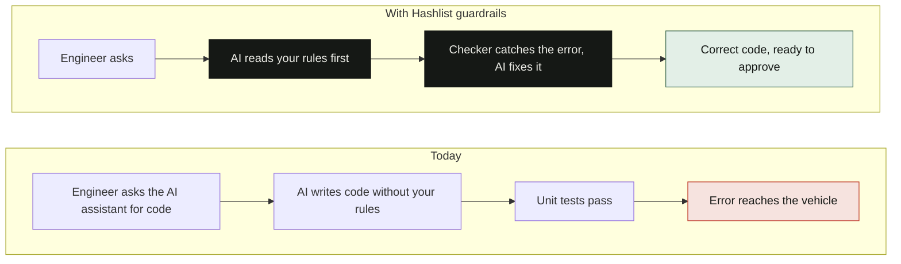
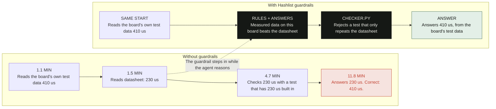
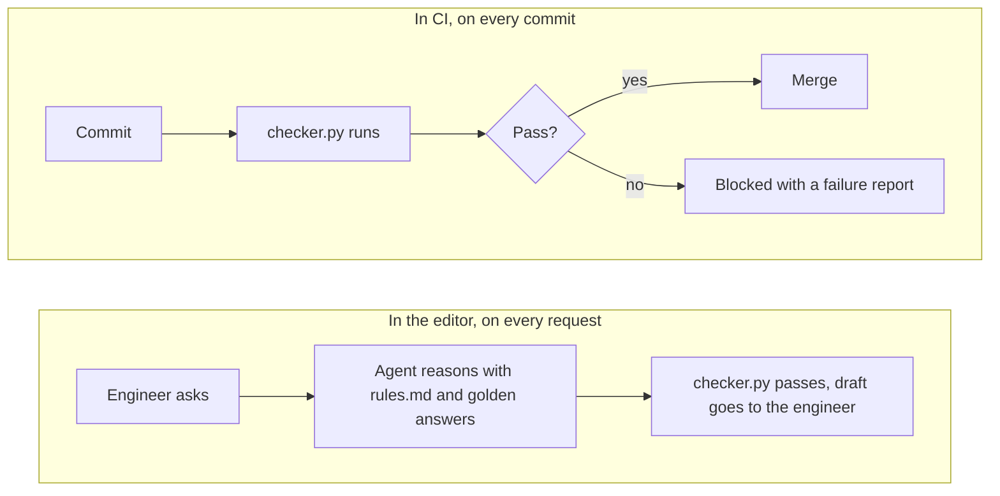
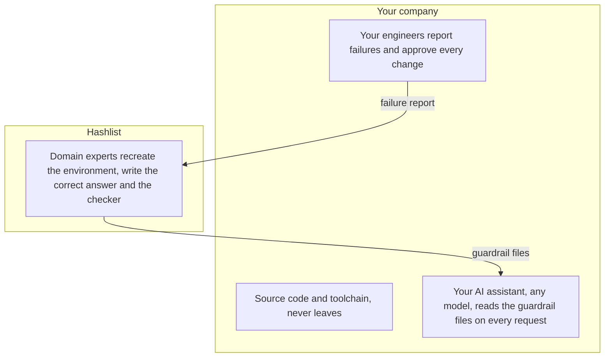
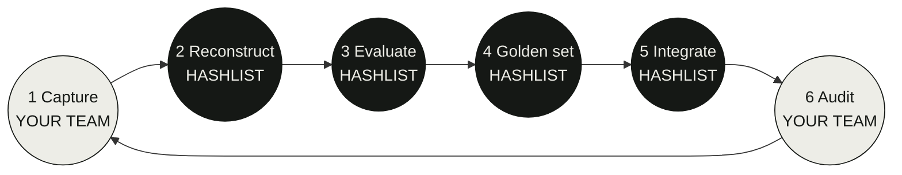

# Hashlist guardrail files, a demo repository

**Guardrail files for the AI coding assistants in your embedded team.** This repository is a working demo of the 4 files [Hashlist](https://hashlist.com) delivers into your repository. A rules file the agent reads, golden answers it looks up, a checker that tests every change, and failure reports that explain why each rule exists.

> All code, boards and failures in this repository are fictional demo data. The project is "demo-ecu rev B", a made-up brake and chassis gateway on an STM32H7. Nothing here comes from a real product or a real customer.

<p align="center">
  
</p>

AI-generated code can pass its unit tests and still break your engineering rules. In this demo an assistant writes a 230 us power-up delay from the datasheet, and writes a test that asserts 230 us. Everything is green. The board needs 410 us. The guardrail files stop that before the answer reaches the engineer.

## Contents

- [How it works](#how-it-works)
- [Quickstart](#quickstart)
- [The 4 files](#the-4-files)
- [Walkthrough: 230 us datasheet vs 410 us board](#walkthrough-230-us-datasheet-vs-410-us-board)
- [The 10 demo guardrails](#the-10-demo-guardrails)
- [File formats](#file-formats)
- [In the editor and in CI](#in-the-editor-and-in-ci)
- [Your source code stays in house](#your-source-code-stays-in-house)
- [The loop: each failure is fixed once](#the-loop-each-failure-is-fixed-once)
- [Add a failure](#add-a-failure)
- [Repository layout](#repository-layout)
- [Talk to us](#talk-to-us)

## How it works

Without guardrails the assistant writes code without your rules, the unit tests pass, and the error reaches the vehicle. With guardrails the assistant reads your rules first, the checker catches the error, the assistant fixes it, and the engineer gets correct code ready to approve.



The guardrail acts inside the agent's reasoning, before the answer reaches the engineer. The agent reads `rules.md`, checks the golden answer database, and verifies its own output with `checker.py`.

## Quickstart

You need Python 3.10 or newer. There is nothing to install. It runs on Linux, macOS and Windows.

```sh
git clone <this repository>
cd <this repository>

python guardrails/checker.py              # check src/, prints: pass · all rules
python guardrails/checker.py --examples   # every AI draft fails, every fixed draft passes
python -m unittest discover -s guardrails/tests

./scripts/demo.sh                         # shows one fail, then the fix passing
make check                                # same as the first line (also: make examples, make test, make all)
```

The checker prints in the style of the Hashlist site status bar:

```text
$ python guardrails/checker.py --path examples/HL-0001/fail
checker.py  R-001 fail · PMIC_3V3_SETTLE_US is 230 us, board measured 410 us (see HL-0001)
            at examples/HL-0001/fail/src/bsp/power.c:6
            golden GA-001: 410 us
            not: 230 us (datasheet typical)
            report guardrails/failure-reports/HL-0001-pmic-settle-time.md
checker.py  R-001 fail · test repeats the value of PMIC_3V3_SETTLE_US as a literal (see HL-0001)
            at examples/HL-0001/fail/test/test_power.c:7
checker.py  fail · 2 finding(s) in R-001

$ python guardrails/checker.py --path examples/HL-0001/pass
checker.py  pass · all rules
```

<p align="center">
  
</p>

Options:

| Flag | What it does |
|---|---|
| (none) | Checks `src/`. Exit code 1 on any failure. |
| `--path DIR` | Checks one draft tree, for example `examples/HL-0003/fail`. |
| `--json` | Machine readable result for agents, with the golden answer and report path per finding. |
| `--ci` | Prints GitHub annotations and a markdown summary (also written to the job summary). |
| `--examples` | Proves every `fail` draft is caught by its own rule and every `pass` draft is clean. |

On a failure the checker prints the rule, the golden answer and the failure report path. That is what lets the agent correct itself.

## The 4 files

These live in your repository, in `guardrails/`. Any AI coding assistant can read them, and any CI pipeline can run them.

| File | What it is |
|---|---|
| [`rules.md`](guardrails/rules.md) | What the agent must do on your stack. |
| [`golden-answers.jsonl`](guardrails/golden-answers.jsonl) | Correct answers it looks up while it reasons. |
| [`checker.py`](guardrails/checker.py) | Tests every change against the rules. |
| [`failure-reports/`](guardrails/failure-reports) | Why each rule exists, for reviews and audits. |

Every rule links back to its failure, and every failure report lists where AI helps and where it fails, with the first wrong step marked.

## Walkthrough: 230 us datasheet vs 410 us board

Scenario HL-0001. The prompt is: *Add the power-up delay for the 3V3 rail before enabling the CAN transceiver.*

<p align="center">
  
</p>

The same story as a chart, with the agent's own timestamps:



Step by step, using the real files in this repository:

1. **The failure.** The assistant had `board/demo-ecu-rev-b/measurements.csv` in front of it (`pmic_3v3_settle,410,us`) and still wrote [`examples/HL-0001/fail/src/bsp/power.c`](examples/HL-0001/fail/src/bsp/power.c) with `#define PMIC_3V3_SETTLE_US 230u /* datasheet typical */`. It then wrote a test that asserts `230u` against that constant, so the unit tests pass. The first wrong step is step 4 of the trace: it decided the datasheet is the authority over the measurement. See [`HL-0001`](guardrails/failure-reports/HL-0001-pmic-settle-time.md).
2. **The rule.** [`R-001`](guardrails/rules.md): measured board data beats the datasheet for timing values, and a test must not assert the same constant it checks.
3. **The golden answer.** `GA-001` in `golden-answers.jsonl`: *How long must firmware wait for the PMIC 3V3 rail to settle on demo-ecu rev B?* Answer `410 us`, not `230 us (datasheet typical)`, source `measurements.csv#pmic_3v3_settle`.
4. **The checker.** Rule R-001 reads the define from the C file, evaluates it, and compares it with the measurement. It also scans `test/` for an assertion that sets a number against the constant. Both fire on the failing draft, as shown above.
5. **The fix.** The agent reads the golden answer, sets `410u`, and replaces the self-referencing test with a comparison against `BOARD_PMIC_3V3_SETTLE_US` taken from the measurement ([`examples/HL-0001/pass`](examples/HL-0001/pass)). The checker prints `pass · all rules`.
6. **The audit.** The engineer re-runs the original prompt ([`HL-0001.prompt.md`](guardrails/prompts/HL-0001.prompt.md)) and confirms the fix. In the failure report, 8 anonymised demo models were re-run 3 times each: 3 of 24 attempts passed before the guardrail files, 24 of 24 with them. This is demo data, not a benchmark.

## The 10 demo guardrails

Each scenario has a prompt, a wrong AI draft in `examples/HL-000N/fail`, a corrected draft in `examples/HL-000N/pass`, a rule, a golden answer, a failure report and a deterministic check.

| Id | Failure | Root cause category | What the checker does |
|---|---|---|---|
| R-001 | PMIC settle time: datasheet value and a self-referencing test | Trusted a document over the data | Compares `PMIC_3V3_SETTLE_US` and similar defines with `measurements.csv`, rejects tests that assert a literal against the constant |
| R-002 | Wheel speed scaling kept at the sheet value | Trusted a document over the data | Evaluates the scale expression and checks speed error stays under 0.2% on the golden roller vectors |
| R-003 | CAN signal packed Intel instead of Motorola | Misread what code or hardware does | Parses `demo.dbc`, runs the encoder statements on four pressures, compares with a DBC bit packer |
| R-004 | E2E CRC and counter copied from a non safety message | Kept the shipped code as reference | Runs the CRC with the file's parameters on `123456789`, expects the J1850 value `0x4B`, requires a counter that wraps at 14 |
| R-005 | Shared ISR variable, torn 64-bit read | Misread what code or hardware does | Finds variables written in `*_IRQHandler`, requires `volatile`, requires 64-bit reads inside `__disable_irq()` and `__enable_irq()` |
| R-006 | `printf`, `xQueueSend`, `HAL_Delay` inside an ISR | Misread what code or hardware does | Scans every ISR body for blocking, printing and allocating calls |
| R-007 | UART DMA buffer ignores the Cortex-M7 D-cache | Kept the shipped code as reference | Requires `aligned(32)`, a 32 byte multiple size and a cache clean before TX (or `.dma_nocache`) |
| R-008 | Watchdog refreshed from the SysTick ISR | Misread what code or hardware does | Allows `HAL_IWDG_Refresh` only inside `Wdg_MainFunction`, after `Wdg_AllAliveOk()` |
| R-009 | `realloc` to grow the DTC list | Trusted a document over the data | Rejects heap calls outside `src/startup/` (MISRA C:2012 Rule 21.3) |
| R-010 | SWC calls `Com_SendSignal` directly | Kept the shipped code as reference | In `src/swc/`, allows only `Rte_` calls and rejects `Com_`, `CanIf_`, `Can_` calls and includes |

The checker uses regular expressions and small parsers for C, DBC and CSV. It needs no compiler, so it runs in any CI image and inside any editor session. It is deliberately simple: it is a demo of the file format and the loop, and real checkers are written by domain experts for the customer's stack.

## File formats

### `rules.md`

One paragraph telling the agent to read it first, then one block per rule:

```markdown
## R-001 Measured board data beats the datasheet for timing values
Applies to: src/bsp/**, test/**, any constant ending in _US or _MS
Must: Take regulator, PHY and oscillator settle times from board/demo-ecu-rev-b/measurements.csv or golden-answers.jsonl. ...
Must not: Write a test that asserts the same constant it checks ...
Check: checker.py rule R-001
Golden answers: GA-001
Why: failure-reports/HL-0001-pmic-settle-time.md
```

### `golden-answers.jsonl`

One JSON object per line. The agent looks entries up by question while it reasons.

```json
{"id":"GA-001","rule":"R-001","question":"How long must firmware wait for the PMIC 3V3 rail to settle on demo-ecu rev B?","answer":"410 us","value":410,"unit":"us","source":"board/demo-ecu-rev-b/measurements.csv#pmic_3v3_settle","not":"230 us (datasheet typical)","applies_to":["src/bsp/power.c"],"verified_by":"Power electronics engineer","failure_report":"HL-0001"}
```

`not` records the tempting wrong answer. `source` points at the data that makes the answer true. Some entries carry extra fields the checker uses, such as the roller vectors in GA-002.

### `failure-reports/HL-000N-*.md`

Prompt, agent trace with the first wrong step marked, expected result, files, root cause category, reproduction, a re-run table across 8 anonymised models (passes out of 3, before and after), matched expert role, fix (rule, golden answer, checker) and an audit entry with a date. Model names are anonymised on purpose: the reports make no claims about any vendor.

### `checker.py`

Python standard library only. Each rule is a small function `rNNN(tree) -> list[Finding]`. Add a rule by writing one function, adding it to `RULES` and `run_rules`, and adding a `fail` and a `pass` example. The unit tests then check that the fail draft trips exactly that rule and the pass draft is clean.

## In the editor and in CI



**Editor path.** [`AGENTS.md`](AGENTS.md) tells any AI coding agent to read `guardrails/rules.md` first, look up `golden-answers.jsonl`, and run `checker.py` before it answers. Short pointer files send the common tools to the same place: [`CLAUDE.md`](CLAUDE.md), [`.cursor/rules/guardrails.mdc`](.cursor/rules/guardrails.mdc) and [`.github/copilot-instructions.md`](.github/copilot-instructions.md). The guardrails are plain files, so they work with any assistant and any model.

**CI path.** [`.github/workflows/guardrails.yml`](.github/workflows/guardrails.yml) runs on every push and pull request. It checks `src/` (with `--ci`, so failures show as annotations and a summary table), proves every fail draft still fails, and runs the unit tests. A rule violation blocks the merge and points to the failure report.

## Your source code stays in house



Only a failure report crosses to Hashlist, and only guardrail files come back. Hashlist domain experts recreate the environment, then write the correct answer and the checker for your domain. Your engineers report AI failures and approve every change.

## The loop: each failure is fixed once

Each failure is fixed once, and the fix applies across your engineering organisation.

<p align="center">
  
</p>



| Step | Name | What happens | Who |
|---|---|---|---|
| 1 | Capture | Your engineers report an AI failure | Your team |
| 2 | Reconstruct | Experts recreate the environment | Hashlist |
| 3 | Evaluate | The failure is re-run across AI models | Hashlist |
| 4 | Golden set | The correct answer and checker are written | Hashlist |
| 5 | Integrate | Rules and checker go into your toolchain | Hashlist |
| 6 | Audit | Your engineers re-run the prompt to check the fix | Your team |

Your engineers spend minutes on steps 1 and 6. Hashlist carries steps 2 to 5. In this repository, step 6 is the file [`guardrails/prompts/`](guardrails/prompts): re-run the prompt, run the checker, read the audit entry in the failure report.

## Add a failure

If an AI assistant gets something wrong that the rules did not catch, open an issue with the [AI failure template](.github/ISSUE_TEMPLATE/ai-failure.yml). It asks for the same four things as step 1: the prompt, the agent trace, the expected result and the files. In a real engagement the failure is reproduced, re-run on other models, and turned into a rule, a golden answer, a checker and a failure report.

To add one to this demo by hand: write the `fail` and `pass` drafts under `examples/HL-00NN/`, add the rule block, the golden answer line and the failure report, add the rule function to `checker.py`, then run `make all`.

## Repository layout

```text
README.md  AGENTS.md  CLAUDE.md  LICENSE  Makefile  checker.py (entry point)
.cursor/rules/guardrails.mdc        pointer for Cursor
.github/copilot-instructions.md     pointer for Copilot
.github/workflows/guardrails.yml    CI: checker on every commit
.github/ISSUE_TEMPLATE/ai-failure.yml   capture form
guardrails/
  rules.md                          the 10 rules
  golden-answers.jsonl              the 10 golden answers
  checker.py                        the checker (standard library only)
  failure-reports/HL-0001..0010     one report per failure
  prompts/HL-0001..0010.prompt.md   original prompts for audit re-runs
  tests/test_checker.py             unit tests
src/                                demo ECU code, passes every rule
test/                               demo unit tests, pass every rule
board/demo-ecu-rev-b/               measurements.csv, demo.dbc (fictional)
examples/HL-0001..0010/{fail,pass}  the AI draft and the fixed draft
assets/                             animated SVGs used in this README
scripts/demo.sh                     fail, then pass
scripts/make_assets.py              regenerates assets/*.svg
```

## Talk to us

Hashlist builds guardrail files, private evals and checkers for the AI inside your engineering toolchain: [hashlist.com](https://hashlist.com).

## License

MIT, see [LICENSE](LICENSE). All code, boards and failures in this repository are fictional demo data.
